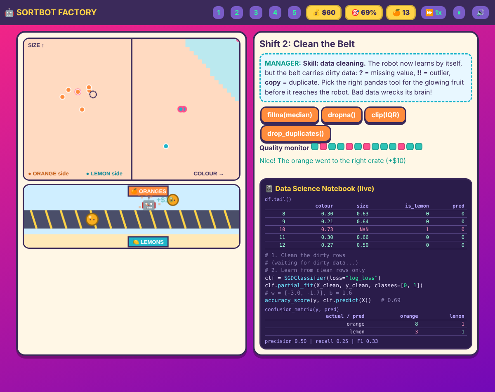

# 🤖 Sortbot Factory

**Learn data science by playing.**

You run a fruit-sorting factory and teach a robot to tell oranges from lemons. Each of the 5 shifts is a different real data science job. A live **Data Science Notebook** next to the game shows the Python (pandas / scikit-learn), DataFrame rows and confusion matrix updating as you play.



## 🎮 Play the Game

**[🚀 CLICK HERE TO PLAY SORTBOT FACTORY](https://sricharan3116.github.io/IDSE-Project/)**

## The 5 Shifts

| # | Shift | Data science skill | What you do | What you learn |
|---|---|---|---|---|
| 1 | Draw the Line | Classification | Drag two handles to place a line on the colour/size map | A classifier is a **decision boundary** |
| 2 | Clean the Belt | Data cleaning | Pick the right pandas tool (`fillna`, `dropna`, `clip`, `drop_duplicates`) | Missing values, outliers and duplicates corrupt a model |
| 3 | Pick the Sensors | Feature selection and leakage | Choose 2 of 5 sensors | Good features must be informative and available in production |
| 4 | Tune the Brain | Overfitting (k-NN) | Set `k` and memory size while 20% of labels are wrong | Tiny `k` memorises noise |
| 5 | Drift Watch | Monitoring and retraining | Monitor quality and press **Retrain** at the right time ($25 each) | Deployed models decay when data drifts |

Stars are earned from profit. There is no game over: replay any shift from the numbered buttons.

## 📊 The Live Notebook

For every fruit the robot sorts, the notebook updates:

- `df.tail()`: latest rows (green = correct, pink = mistake).
- Python code for the current step (`LogisticRegression`, `SGDClassifier`, `KNeighborsClassifier`, cleaning calls).
- `confusion_matrix` plus precision, recall and F1.

## 🛠️ Technologies Used

- HTML
- CSS
- JavaScript
- Canvas API
- Web Audio API

The classifiers (online logistic regression, batch retraining, k-NN) are implemented in plain JavaScript.

The only external resource is an optional Google Font (Fredoka) with a system fallback.

## 🚀 Run Locally

1. Clone the repository:

   `git clone https://github.com/Sricharan3116/IDSE-Project.git`

2. Open the project folder.
3. Double-click `index.html`.

No build step, no dependencies.

## 📁 Project Structure

```text
IDSE-Project/
├── index.html
├── assets/
│   └── screenshot.png
├── README.md
└── LICENSE
```

## 💡 Ideas to Extend

- Add a shift on train/test splits or cross-validation.
- Let players edit the Python code and run it.
- Save best stars with `localStorage`.

## 📄 License

MIT License

---

**Developed as an IDSE Project.**

🎮 [Play Sortbot Factory](https://sricharan3116.github.io/IDSE-Project/)

📁 [View GitHub Repository](https://github.com/Sricharan3116/IDSE-Project)
